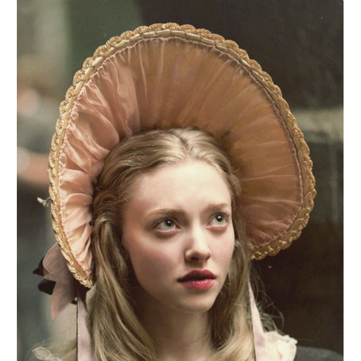
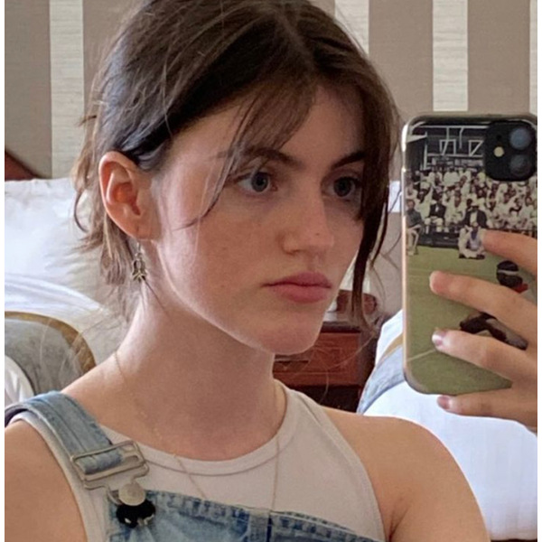
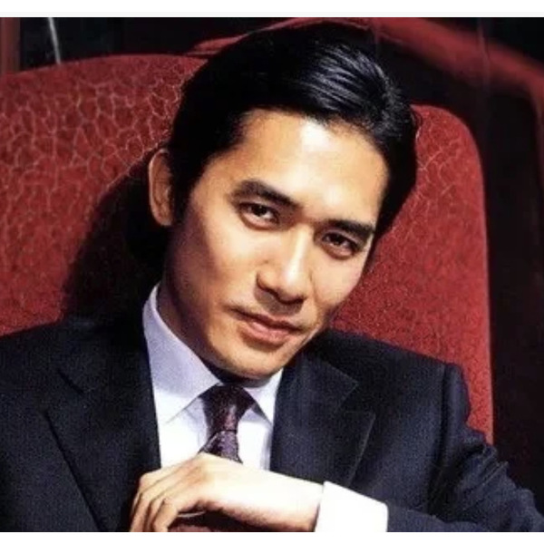
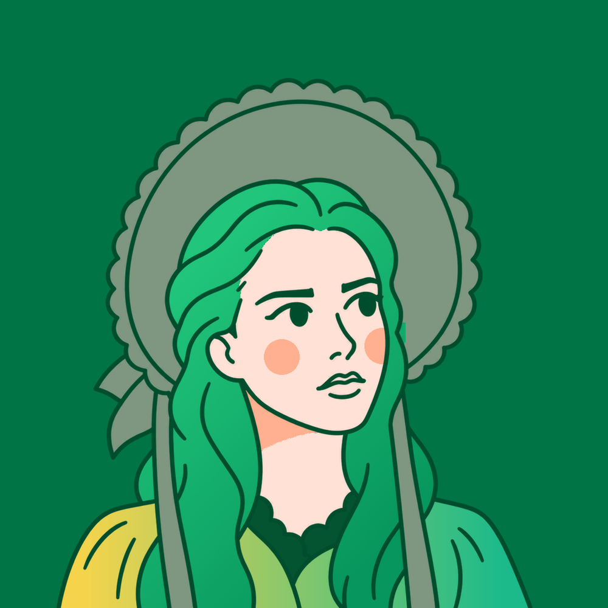
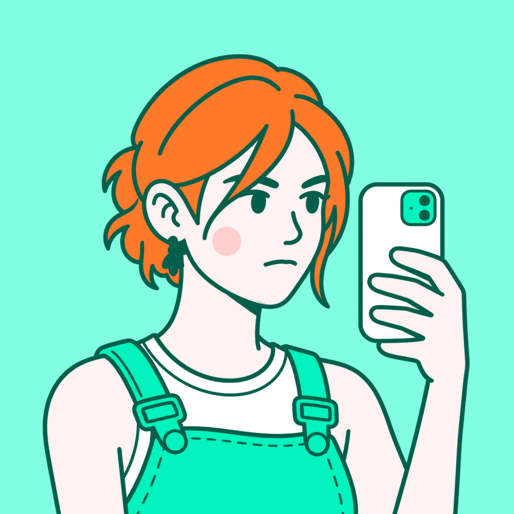
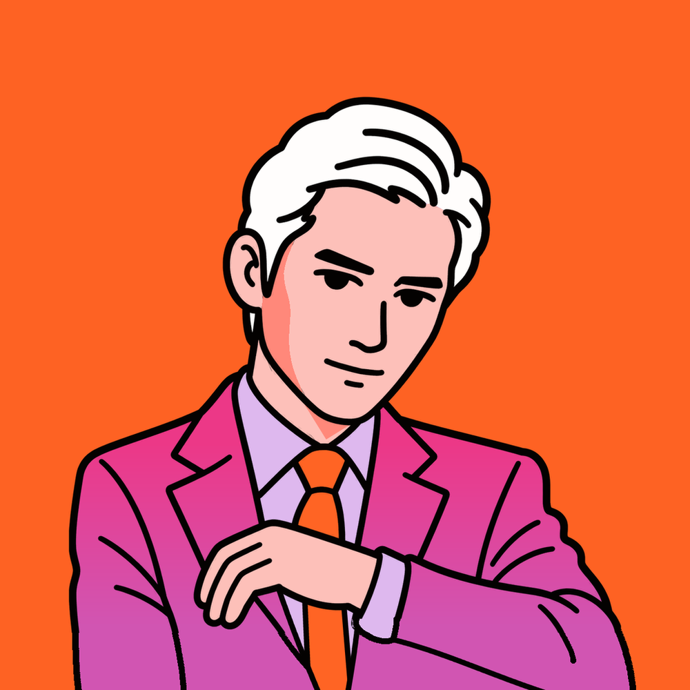

# 碳水头像

把人物照片变成平面线描头像。

保留脸型、发型、表情与姿势，用简化五官、统一线条、轻腮红和分层衣饰，画出有辨识度的人物。

[下载与安装包](https://github.com/tanshuisir/tanshui-touxiang-skill/releases/latest) · [Skill 规则](SKILL.md) · [模板库](references/finished-reference-index.md)

## 效果对照

上排为原始照片，下排为对应的已确认头像。

<table>
  <tr>
    <td align="center"></td>
    <td align="center"></td>
    <td align="center"></td>
  </tr>
  <tr>
    <td align="center"></td>
    <td align="center"></td>
    <td align="center"></td>
  </tr>
  <tr>
    <td align="center"><sub>帽饰与视线</sub></td>
    <td align="center"><sub>姿态与衣饰</sub></td>
    <td align="center"><sub>服装与遮挡</sub></td>
  </tr>
</table>

## 主要特点

- **人物特征**：保留真实的五官关系、发型剪影、视线和表情，避免所有人变成同一张脸。
- **一致画法**：实心符号眼形、自然嘴形、轻淡腮红、下巴投影；衣褶使用疏密适当的线条，衣物分层与首饰保持可读。
- **完整配色**：每版从同一模板取线色、肤色、背景、头发、外衣、内搭和细节色，不随意跨模板拼凑。
- **减少重复**：70 套按持久历史不放回抽取，相邻批次排除上一批模板；不同模板可能有相同 HEX，不承诺所有单个颜色互不相同。
- **两种交付**：单张头像，或一次生成底稿后本地输出同线稿四配色。先看预览，确认后再生成高清。
- **结构检查**：关注被裁切的肩袖、抬臂遮挡、衣领内搭、道具分区和人物贴底；自动检查不替代人物相似度及解剖结构的视觉判断。

默认背景为所选模板的纯色、不透明、满幅背景，包括模板中已有的白色或近白色。另保留 100 组用户提供的四色卡作为独立参考，默认不混入随机模板库；自定义配色可按规则从 Coolors 或 Color Hunt 选择。

当前模板库为 **TS-001—TS-070**，参考 PNG 整理为 1000×1000，并附角色色值、取色坐标与画法索引。完整素材可从[模板索引](references/finished-reference-index.md)查看，或[单独下载](https://github.com/tanshuisir/tanshui-touxiang-skill/releases/latest)。部分素材经过尺寸适配，不表示每张都是模型原生高清输出。

## 快速使用

在 Codex 中提供人物照片并输入：

```text
使用 $tanshui-touxiang-skill 出图。
```

默认同线稿四配色。需要单张或指定新模板时，可以说：

```text
使用 $tanshui-touxiang-skill，只出一张，使用 TS-050 的完整配色。
```

## 安装与依赖

此仓库是 **Skill 指令、脚本与参考素材**，不包含图像模型、网关账户或凭据。当前执行器调用全局 `gen-img` Skill 的公司 AI Gateway；需要自行具备可用的该后端与认证配置。仅安装本仓库不会为没有后端的模型增加生图能力。

需要 Python 3.10+、Pillow，以及已配置的 `gen-img`（默认位于 `${CODEX_HOME:-$HOME/.codex}/skills/gen-img`，其运行依赖由 `uv` 管理）。模型列表、自动选择和失败处理均须精确排除 `gpt-image-2`；`gpt-image-2.5-flare` 和 `gpt-image-2.5-sunburst` 不在该排除范围内。

首次安装可克隆到 Codex 的 Skills 目录：

```bash
git clone https://github.com/tanshuisir/tanshui-touxiang-skill.git "${CODEX_HOME:-$HOME/.codex}/skills/tanshui-touxiang-skill"
python3 -m pip install -r "${CODEX_HOME:-$HOME/.codex}/skills/tanshui-touxiang-skill/requirements.txt"
```

也可下载 Release 中的 `tanshui-touxiang-skill-v2.0.0.zip`，解压后将整个 `tanshui-touxiang-skill` 文件夹放入 Skills 目录。已有安装请先保存自己的改动，避免直接覆盖。

<details>
<summary>命令行使用与运行说明</summary>

脚本应从当前项目工作区运行，生成产物不会写回 Skill 安装目录：

```bash
# 默认四配色
python3 "<skill-dir>/scripts/run_avatar.py" --photo "<absolute-photo>"

# 单张，指定 TS-050 的完整配色
python3 "<skill-dir>/scripts/run_avatar.py" --photo "<absolute-photo>" --variants 1 --colorway-reference 50
```

执行器保存输入、冻结配色、提示词、模型结果与交付路径。预览默认使用 low 质量；生成模型的实际尺寸会被记录，必要的方形适配不是重新生图。90 秒是交付目标，实际时间受后端排队与模型响应影响。失败或状态不明时先检查本次结果，不自动重复收费请求。

旧版本的冻结配色不能通过相同编号直接套用到新库；请从照片创建新任务。新库使用独立抽色账本，当前模板的编号、像素采样和哈希共同用于核验来源。

</details>

## 文件与下载

| 内容 | 位置 |
| --- | --- |
| 核心规则 | [SKILL.md](SKILL.md) |
| 70 张参考 PNG | [assets/templates](assets/templates) |
| 模板与完整配色 | [references/finished-reference-index.md](references/finished-reference-index.md)、[references/source-colorways.json](references/source-colorways.json) |
| 画法与结构 | [references/style-language.md](references/style-language.md)、[references/structure-continuity.md](references/structure-continuity.md) |
| 取色与素材说明 | [ASSET_SOURCES.md](ASSET_SOURCES.md) |
| 完整安装包、独立模板包 | [GitHub Releases](https://github.com/tanshuisir/tanshui-touxiang-skill/releases/latest) |

离线检查可在仓库根目录执行：

```bash
python3 -m unittest discover -s tests
```

本仓库未附加统一开源许可证。展示照片和其他素材的权利归各自权利人，公开展示不等于获得任意再分发或商业使用许可；请按实际用途核实相应授权。
