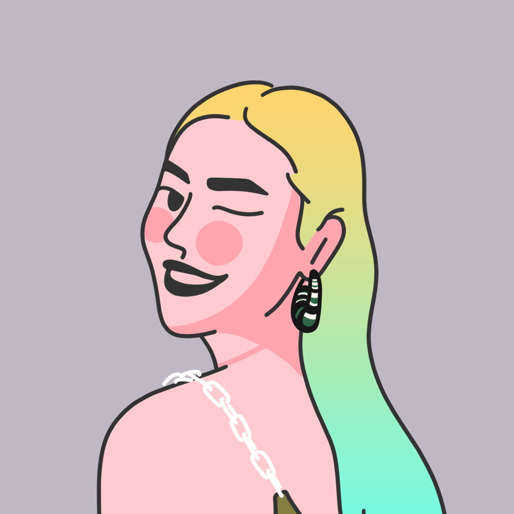
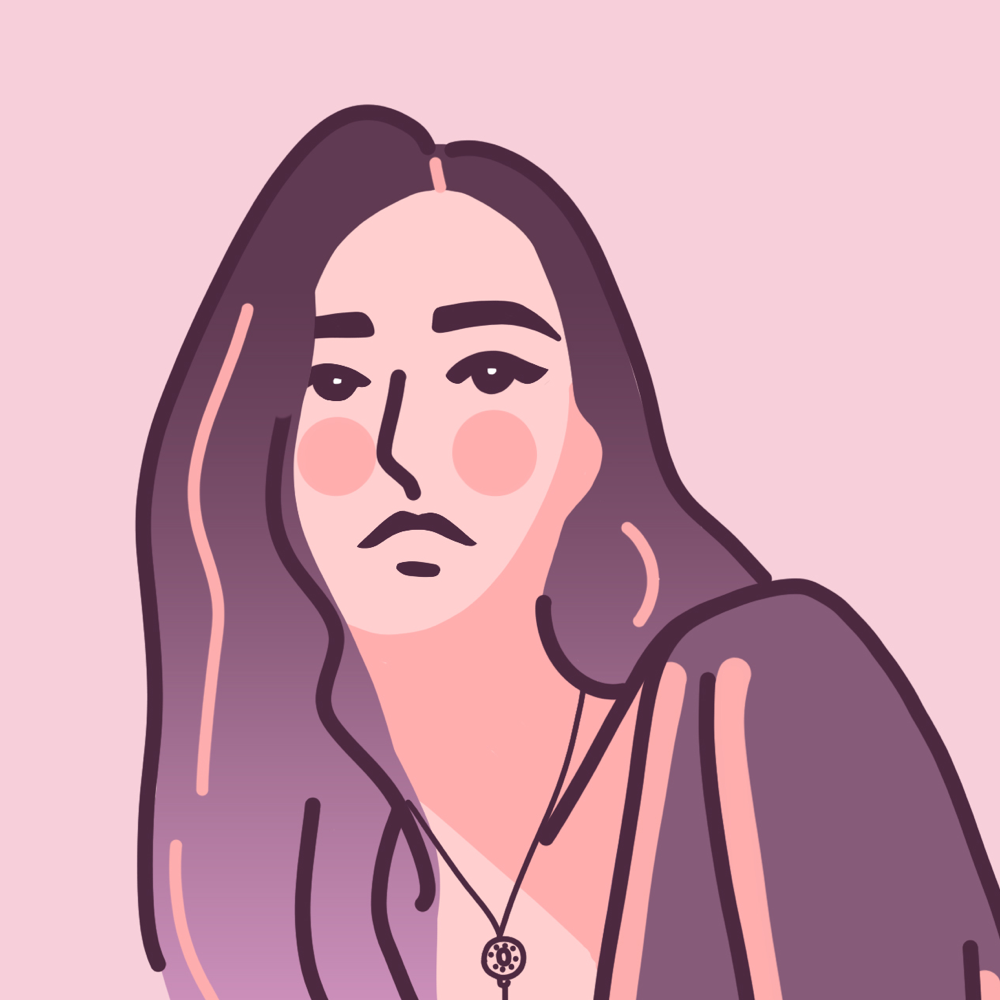

# 碳水头像 Skill

将真人照片转换为具有辨识特征的人物头像插图：保留脸型、发型、眉眼关系、神态与关键配饰，采用艺术配色、平顺轮廓和局部渐变。默认先生成 **512×512 预览**，经用户对话确认后，再生成 **1000×1000 PNG 高清头像**。

仓库名称为 `tanshui-touxiang-skill`，安装后的 Skill 名称保留为 `photo-avatar-illustrator`，可在 Codex 中通过 `$photo-avatar-illustrator` 调用。

## 工作方式

| 阶段 | 发给模型的默认请求 | 交付与后续动作 |
|---|---|---|
| 预览 | 512×512、`quality low` | 展示 512×512 PNG 后等待用户确认；修改意见继续用于预览 |
| 高清 | 1024×1024、`quality high` | 沿用原照片、已认可预览、画风与配色，生成后等比整理为 1000×1000 PNG |

高清阶段会重新生成，**不会把 512 预览放大冒充高清**。用户一开始明确要求直接高清时，也可以直接进入高清阶段。

每个阶段默认只提交一次图片请求。失败、超时或状态不明时保留记录并停止，不自动换模型或追加收费重试。上游模型是否支持并执行尺寸、质量等参数，以实际返回结果为准；请求 512×512 不代表所有模型都支持，也不承诺固定耗时、资源节省比例或人物相似度。

## 画风与配色

- 从照片中选取 3–5 项可见特征，只适度加强其中 1–2 项，其余简化；保留年龄、不对称、神态和真实遮挡。
- 默认使用 HD-025 的线条与造型语言：平顺深色轮廓、简化五官、圆腮红、有限色族、少量脸侧硬边暗面和下颌颈影。
- 默认 `expressive` 艺术配色，肤色、发色、服装色与背景色可重新组织；8 套本地色组可自动选择或手动指定。
- 每张头像至少规划一处清楚可见的二色连续局部渐变，优先位于头发、衣服或背景的封闭区域；面部保持图形感。
- 用户明确要求保留自然肤发基调时，使用 `natural`。详细逐项自检仅在用户明确要求时启用。

## 参考插画

以下是参考库中署名 **776／七七六** 的插画，**不是本 Skill 生成的效果展示**。它们用于说明研究的绘画语言，来源与素材范围见 [素材来源说明](ASSET_SOURCES.md)。

| HD-025 | HD-008 | HD-055 |
|---|---|---|
|  |  |  |

## 安装与依赖

需要 **Python 3.10 或更高版本、Pillow，以及已配置的外部 `gen-img` Skill**。本仓库不包含 `gen-img` 本体、网关账号、API 密钥或其他凭据；它们由使用者在本机单独安装和配置。

默认安装到 Codex 的 Skill 目录：

```bash
mkdir -p "$HOME/.codex/skills"
git clone https://github.com/tanshuisir/tanshui-touxiang-skill.git \
  "$HOME/.codex/skills/photo-avatar-illustrator"
python3 -m pip install Pillow
```

如果目标目录已经存在，先保留或备份旧版本，再选择新的安装位置；不要直接覆盖正在使用的 Skill。设置了自定义 `CODEX_HOME` 时，安装位置相应为 `$CODEX_HOME/skills/photo-avatar-illustrator`。

执行器默认在 `$CODEX_HOME/skills/gen-img` 查找依赖；未设置 `CODEX_HOME` 时使用 `~/.codex/skills/gen-img`。其他位置可通过环境变量指定：

```bash
export GEN_IMG_SKILL_DIR="/你的安装路径/gen-img"
```

`gen-img` 需自行完成所用网关的账号、凭据和模型访问配置。照片、风格参考与提示词会由该工具发送到已配置的生图服务；本 Skill 不另写网关请求或在仓库保存凭据。

## 在 Codex 中使用

上传照片后，可以这样提出要求：

> 使用 $photo-avatar-illustrator，把这张照片转为人物头像。保留主要人物特征，采用艺术配色和局部渐变，先出一张预览。

认可预览后回复：

> OK，沿用这个预览的配色与人物特点，生成高清版。

也可以明确指定偏好：

> 保留自然肤色和发色，用自然色模式；头顶眼镜和耳饰要保留，背景简化。

> 请逐项对照检查人物特征与画风，再给出需要修正的具体内容。

后一种要求才会启用详细 `review` 流程；它不代替用户对预览的确认，也不自动升级高清。

## 命令行使用

从自己的项目工作区运行，图片与记录会写入该项目，**不要在 Skill 安装目录中运行生成命令**。

```bash
AVATAR_SKILL="${CODEX_HOME:-$HOME/.codex}/skills/photo-avatar-illustrator"
mkdir -p "$HOME/avatar-project"
cd "$HOME/avatar-project"
```

先根据实际照片填写观察；下面的脸型、发型与神态仅为参数示例：

```bash
python3 "$AVATAR_SKILL/scripts/run_avatar.py" \
  --photo "/绝对路径/人物照片.jpg" \
  --feature "椭圆脸，下颌逐渐收窄，下巴圆润" \
  --feature "侧分短发，额前发束构成清楚剪影" \
  --feature "眉眼间距较近，嘴角略上扬" \
  --expression "闭口微笑，目视镜头" \
  --pose "近正面，头略向一侧倾斜" \
  --clothing "保留照片中可见的衣领与眼镜"
```

默认结果位于项目中的 `outputs/avatars/<时间-随机>/`。`result.json` 记录真实交付文件路径；`brief.json` 保存特征、已选色组与渐变，供确认后复用。

用户确认后，用同一预览目录继续高清阶段：

```bash
python3 "$AVATAR_SKILL/scripts/run_avatar.py" \
  --brief "/绝对路径/预览目录/brief.json" \
  --stage final \
  --approved-preview "/绝对路径/预览目录/avatar.png"
```

如果旧 brief 已显式填写 `size`、`render_size` 或 `quality`，这些字段仍优先；升级时应按本次高清要求更新。尺寸整理保留上游原图，只等比缩小合规的正方形，不拉伸、补框或放大不足分辨率的图片。

常用可选参数：

| 参数 | 用途 |
|---|---|
| `--reference 25` | 选择一张高清造型参考，默认 HD-025 |
| `--mode flat` | 主表现模式；另有 gradient、texture、bold、cartoon、duotone、glitch |
| `--color-mode expressive` | 艺术配色；明确保留自然肤发时使用 natural |
| `--palette mint-apricot` | 固定艺术色组；也可用 auto 或 reference |
| `--model <型号>` | 原样交给 gen-img 校验和调用，不静默换型 |
| `--quality <质量>` | 覆盖阶段默认质量，具体支持情况由后端决定 |
| `--notes "补充要求"` | 记录背景、道具、构图等额外要求 |
| `--out-dir <新目录>` | 指定输出目录，拒绝覆盖非空目录 |

`flat` 表示主体大面平涂，仍须包含指定的局部渐变。更细的尺寸、角色色与渐变参数通过 brief 设置，见 [参数文档](references/prompt-template.md)。只准备提示词而不提交生图时，可使用 `scripts/build_prompt.py`。

## 模型约束

生图和编辑均通过外部 `gen-img` 执行，默认由它选择可用型号。当前偏好**精确排除 `gpt-image-2`**，不是按前缀过滤：`gpt-image-2.5-flare` 和 `gpt-image-2.5-sunburst` 不受此项排除影响，但仍需出现在所用服务的可用目录中。指定型号不可用或被排除时停止；没有其他型号时也停止，不自动绕过偏好。

## 目录结构

```text
.
├── SKILL.md                    Skill 入口和默认工作流
├── agents/openai.yaml          Codex 显示名称与默认提示
├── scripts/                    提示词准备、单次执行、尺寸整理和可选自检
├── references/                 画风、配色、编号与照片来源资料
├── assets/finished/            69 张高清参考及总览，HD-051 缺号
├── assets/portraits/           早期拼版裁出的 100 张参考
├── assets/cases/               有来源记录的照片研究资料
├── tests/                      无网关调用的离线测试
└── ASSET_SOURCES.md             第三方素材来源与范围
```

仓库未收录使用者的私人输入照片、凭据或实际生图输出。参考插画、公开照片和衍生总览的归属分别记录，不能将其视为本项目原创素材或统一许可资产。

## 离线测试

安装 Pillow 后，从 Skill 目录之外的项目工作区运行：

```bash
python3 -m unittest discover \
  -s "$AVATAR_SKILL/tests" \
  -p 'test_*.py'
```

测试使用本地合成图片和模拟网关，验证参数、阶段切换、艺术配色、输出尺寸与失败停止等行为，不读取真实凭据、不调用生图服务，也不证明新照片的生成相似度或用户认可程度。

## 素材说明

参考插画、公开人物照片与分析资料的来源见 [ASSET_SOURCES.md](ASSET_SOURCES.md)。本仓库没有为第三方素材授予 MIT 或其他新许可，也不声称拥有这些素材的版权；来源记录不等于原作者为本 Skill 背书。
